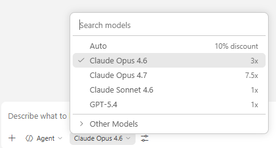

# 시작하기 — Todo 앱 개발 체험 가이드

이 워크스페이스는 AI 에이전트(GitHub Copilot)와 함께 **처음부터 Todo 앱을 만들어 보는** 체험 환경입니다.

만들 앱은 Gmail 메일 내용에서 일정을 추출해 Google Calendar에 자동으로 등록하는 앱입니다.

## 면책 사항(반드시 읽어 주세요)

이 워크스페이스는 학습용 예제입니다. GitHub Copilot 같은 코딩 에이전트는 독자의 지시에 따라 명령을 실행하고, 파일을 만들거나 수정하고, 의존 패키지를 설치할 수 있습니다. 실행 결과와 생성된 코드를 사용할 때는 독자가 직접 책임지고 확인하세요.

실제 Google 계정과 Gmail / Google Calendar를 다루므로 개인 정보·기밀 정보·실제 운영 데이터로는 시험하지 말고, 인증 정보를 채팅이나 저장소에 붙여 넣지 마세요. 이 책과 이 예제의 저자는 이 워크스페이스나 코딩 에이전트를 사용하면서 생긴 손해, 데이터 손실, 정보 유출에 대해 책임지지 않습니다.

---

## 준비물

| 무엇이 필요한가요? | 설명 |
| --- | --- |
| **컴퓨터** | Windows 또는 Mac |
| **VS Code** | 에디터([다운로드](https://code.visualstudio.com/)) |
| **GitHub Copilot** | VS Code 확장 기능(유료 플랜이 필요합니다) |
| **Google 계정** | Gmail과 Google Calendar를 사용합니다 |

> 💡 개발 도구(Node.js, Git 등)는 이 체험 과정에서 설치합니다. 처음부터 설치되어 있지 않아도 괜찮습니다.

---

## 1단계: 저장소를 클론하고 VS Code에서 열기

1. 터미널(Windows: PowerShell, Mac: Terminal.app)을 엽니다.
2. 원하는 위치로 이동한 다음, 다음 명령을 실행합니다.

   ```bash
   git clone https://github.com/TsuyoshiUshio/buka-samples.git
   ```

3. 클론한 폴더를 VS Code로 엽니다.

   ```bash
   code buka-samples
   ```

4. VS Code가 열리면 터미널을 엽니다(`Ctrl + @` / Mac: `` Ctrl + ` ``).

> 💡 `git` 명령을 찾을 수 없다면 먼저 [Git](https://git-scm.com/)을 설치하세요.
> `code` 명령을 찾을 수 없다면 VS Code를 실행한 뒤 `Ctrl+Shift+P`(Mac: `Cmd+Shift+P`) → 'Shell Command: Install 'code' command in PATH'를 실행하세요.

---

## 2단계: AI 모델 설정하기

Copilot 채팅을 가장 잘 활용하려면 **Claude Opus 4.6 이상** 모델을 선택하세요.

### 설정 방법

1. VS Code 왼쪽 사이드바에서 **Copilot 채팅**(💬 아이콘)을 엽니다.
2. 채팅 입력란 아래에 있는 모델 선택 드롭다운을 클릭합니다.
3. **'Claude Opus 4.6'** 또는 그 이후 버전을 선택합니다.



> ⚠️ 목록에 모델이 보이지 않으면 Copilot 구독 플랜을 확인하세요.
> Claude Opus 4.6은 Copilot Pro / Business / Enterprise 플랜에서 사용할 수 있습니다.

---

## 3단계: 개발 환경 설정하기

채팅에 `/setup`을 입력하면 AI가 모든 준비를 도와줍니다.

`/setup`이 해 주는 일:

1. **AI 모델과 설정 확인** — Claude Opus 4.6이 선택되어 있는지 확인하고, 작업 자동 승인(Auto-Approve)을 설정합니다.
2. **언어 확인** — 일본어로 진행해도 되는지 확인합니다.
3. **도구 점검** — 컴퓨터에 필요한 소프트웨어가 설치되어 있는지 확인하고, 부족하면 설치를 제안합니다.
4. **Google API 설정** — Gmail과 Google Calendar를 사용하기 위한 설정을 대화형으로 한 단계씩 안내합니다.
5. **프로젝트 초기화** — TypeScript 등 개발에 필요한 패키지를 설치합니다.

AI가 단계마다 '다음에는 이걸 하세요'라고 알려 주므로 안내를 따르기만 하면 됩니다.

> ⚠️ `/setup`에서는 확인 대화 상자를 줄이기 위해 **Bypass Approvals**를 안내할 수 있습니다.
> 이것은 Copilot이 명령 실행이나 파일 편집을 매번 확인받지 않고 진행하는 설정입니다.
> 이 학습용 워크스페이스에서만, 진행 내용을 지켜보면서, 독자 스스로의 책임하에 사용하세요.
> 설정과 학습이 끝나면 **Default Approvals**로 되돌리기를 권장합니다.

> 💡 Google 인증 정보는 워크스페이스 **바깥**의 안전한 위치(`~/.todo-app/`)에 저장됩니다.
> 이렇게 해서 AI가 실수로 인증 정보를 읽는 일을 막습니다.

---

## 4단계: 개발 시작하기

준비가 끝났으면 채팅으로 하고 싶은 일을 말해 주세요!

### 추천하는 시작 방법

1. 먼저 `/plan-checklist`를 입력해 할 일 목록을 만듭니다.
2. 이어서 `/dev-tdd`를 입력해 테스트 주도 방식으로 개발을 진행합니다.

### 대화 예시

```text
나: Gmail에서 메일을 가져오는 기능을 만들고 싶어
AI: 알겠습니다! 먼저 테스트부터 작성해 봅시다. 메일을 가져올 때 무엇을 확인하고 싶으세요?
```

---

## 사용할 수 있는 명령 목록

채팅에 `/`를 입력하면 다음 명령을 사용할 수 있습니다.

| 명령 | 설명 |
| --- | --- |
| `/setup` | 개발 환경 설정(처음에 한 번 실행) |
| `/plan-checklist` | 작업 전에 할 일 목록 작성 |
| `/dev-tdd` | 테스트 주도 개발로 기능 구현 |
| `/cleanup` | 완료한 체크리스트 파일 정리 |
| `/help` | 문제가 생겼을 때 트러블슈팅 |
| `/skill-creator` | 새 AI 스킬 만들기 |

---

## 문제가 생겼을 때

채팅에 `/help`를 입력하고 상황을 설명하면 AI가 문제 해결을 도와줍니다.

| 상황 | 대처 방법 |
| --- | --- |
| 명령이 동작하지 않는다 | `/setup`을 다시 실행해 환경을 확인 |
| 테스트가 통과하지 않는다 | AI에게 '테스트가 실패하고 있어요. 원인을 찾아 주세요'라고 말하기 |
| 잘 모르는 오류가 난다 | 오류 메시지를 그대로 채팅에 붙여 넣기 |
| 처음부터 다시 하고 싶다 | AI에게 '이 기능을 다시 만들고 싶어요'라고 말하기 |

---

## 💡 팁: 잘 안 될 때 알아 둘 것

### 화면이나 절차가 README와 다를 때

Google Cloud Console과 VS Code는 자주 업데이트되므로 이 가이드의 설명과 실제 화면이 다를 수 있습니다.
**당황하지 않아도 됩니다.** 화면을 캡처해 채팅에 붙여 넣고 '이 화면에서 다음에 뭘 하면 돼?'라고 물어보세요. AI가 최신 화면을 바탕으로 안내해 줍니다.

**화면 캡처 방법:**

| OS | 조작 | 설명 |
| --- | --- | --- |
| **Windows** | `Win + Shift + S` | 영역을 선택해 화면을 캡처합니다. 클립보드에 복사되므로 채팅에 `Ctrl + V`로 붙여 넣습니다 |
| **Mac** | `Cmd + Shift + 4` | 영역을 선택해 화면을 캡처합니다. 데스크톱에 저장되므로 채팅에 끌어다 놓습니다 |
| **Mac** | `Cmd + Ctrl + Shift + 4` | 영역을 선택해 클립보드에 복사합니다. 채팅에 `Cmd + V`로 붙여 넣습니다 |

### AI가 오랫동안(10분 이상) 반응하지 않을 때

에이전트가 무언가에 막혀 있을 수 있습니다.

1. **Stop 버튼**(채팅의 ■ 아이콘)을 눌러 일단 멈추세요.
2. '어디에서 막혔나요? 상황을 알려 주세요'라고 물어보세요.
3. 그래도 해결되지 않으면 **다른 모델을 사용해 보세요**(채팅 하단의 모델 선택에서 전환). 모델마다 잘하는 일과 못하는 일이 있어서 다른 관점으로 해결될 때가 있습니다.

### 그 밖에 알아 둘 것

- **오류가 나면 일단 그대로 붙여 넣기** — 오류 메시지를 직접 해석하려고 하지 않아도 됩니다. 그대로 채팅에 붙여 넣으면 AI가 읽고 풀어 줍니다.
- **'모르겠어요'라고 말해도 괜찮습니다** — 질문에 답하는 것이 AI의 일입니다. 부담 없이 물어보세요.
- **작게 나눠서 진행하기** — 한 번에 큰일을 하려 하지 말고 기능을 하나씩 만들어 가는 것이 요령입니다.

---

## 이 워크스페이스의 구성

```text
todo/
├── README.md                     ← 이 파일
├── AGENTS.md                     ← AI에게 주는 지시서(자동으로 읽힘)
├── .gitignore                    ← Git에 포함하지 않을 파일 설정
└── .github/
    ├── prompts/                  ← AI에게 주는 작업 지시(/명령)
    │   ├── plan-checklist.prompt.md
    │   ├── dev-tdd.prompt.md
    │   ├── cleanup.prompt.md
    │   └── help.prompt.md
    ├── instructions/             ← 공통 규칙(AI가 자동으로 참조)
    │   ├── checklist-workflow.instructions.md
    │   ├── tdd-workflow.instructions.md
    │   └── security.instructions.md
    └── skills/                   ← AI 스킬
        ├── setup/                ← /setup에서 쓰는 환경 구축 스킬
        └── skill-creator/        ← 새 스킬을 만드는 스킬
```

---

즐겁게 만들어 보세요! 🎉

---

## 부록: 다른 AI 코딩 에이전트에서 사용하기

이 워크스페이스는 GitHub Copilot(VS Code)용으로 구성되어 있지만 다른 AI 코딩 에이전트에서도 사용할 수 있습니다.
클론한 다음, 각 에이전트의 채팅에 다음과 같이 말해 보세요.

```text
이 폴더에 GitHub Copilot용 instructions/skills/prompt(slash command)/AGENTS.md
가 있습니다. 이것들을 당신의 환경에서 쓸 수 있도록 변환해 주세요.
```

각 에이전트가 `.github/` 아래 파일을 읽고 자기 형식으로 변환해 줍니다. 예:

| 에이전트 | 변환 결과 예 |
| --- | --- |
| **Claude Code** | `CLAUDE.md`, `.claude/commands/`, `.claude/skills/` |
| **Cursor** | `.cursor/rules/`, `.cursorrules` |
| **Windsurf** | `.windsurfrules` |
| **기타** | 각 에이전트에게 물어보면 알맞은 형식으로 변환해 줍니다 |
